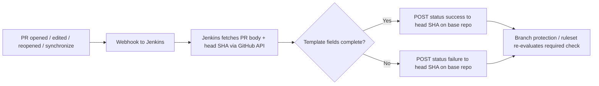

# Pull Request Template & Enforcement via Jenkins

## Executive summary

We want a reliable way to understand the **varying categories of contributions**
to our repositories — bug fixes, new features, security fixes,
dependency updates, documentation, breaking changes, and so on. This is
not captured consistently at the moment, so the value of what people contribute is difficult to ascertain.

Classifying by type matters because line count is a poor proxy for value.
Security fixes are systematically undervalued by volume-based metrics because
they are frequently small, targeted changes.

A standard pull request template captures this context at source, and its
**Type of change** field provides a lightweight, automatable signal for
classifying every contribution at merge time. Because a template alone is only
advisory, a central Jenkins check enforces that the required fields — especially
the category — are completed before a PR can be merged. This helps give a clear and
consistent view of the value that each change delivers.

## Goal

Standardize Pull Request descriptions across repositories and **enforce** that
every PR fills in the required fields. Enforcement runs centrally in a Jenkins
job.

## 1. The Pull Request Template

Define the template **once at the organization level** rather than per repository.
GitHub supports org-wide default community health files: add the template to the
organization's `.github` repository. Any repository in the organization that
does **not** define its own pull request template uses the organization-level
default automatically.

Place the file at one of these paths in the org's `.github` repository (GitHub
checks them in this order):

- `.github/pull_request_template.md`
- `pull_request_template.md` (repository root)
- `docs/pull_request_template.md`

> **Scope:** The `.github` repository must be **public**. Its default files are
> then used for any repository owned by the organization that does not have its
> own template, regardless of that repository's visibility. A repository can
> override the default by committing its own `pull_request_template.md`.
> Because the Jenkins check expects the section headings defined
> below, any repository-level override must keep the same sections, or the check
> will fail for that repository's PRs.

```markdown
## Related issue

<!-- Link the related GitHub issue or Jira ticket. Write "N/A" if none. -->

> If there is no related issue, complete the Problem and solution and Impact sections below.

## Problem and solution

<!-- What is broken, missing, or needed? How does this pull request address it? -->

## Impact

<!-- Describe the expected result of this change. -->

## Type of change

<!-- Select all that apply. -->

- [ ] Bug fix
- [ ] New feature
- [ ] Security fix
- [ ] Performance enhancement
- [ ] Breaking or compatibility-affecting change
- [ ] License, notice, or legal text update
- [ ] Documentation update
- [ ] Refactoring or code quality
- [ ] Test update
- [ ] Build, CI/CD, or maintenance
- [ ] Dependency update
- [ ] Other

## Validation

<!-- Describe the checks performed, including commands and results. If validation is not applicable, explain why. -->

### Automated validation

<!-- Tests, linters, formatting, link checks, or other automated checks. -->

### Manual validation

<!-- Manual review or testing performed. Write "N/A" if none applies. -->

## Compatibility and downstream impact

**Is this a breaking or compatibility-affecting change?**

- [ ] No
- [ ] Yes

<!-- If yes, explain what changes, who is affected, why it is necessary. -->

## Security

<!-- Do not disclose an unpatched vulnerability in a public pull request. Report it privately using the repository's security reporting process or GitHub Private Vulnerability Reporting, where enabled. Once disclosure is safe, describe any non-sensitive security impact here, or write "N/A". -->
```

When a PR is opened through the GitHub web interface, GitHub pre-fills the PR
body with this content (once the template is on the repository's default
branch). PRs created through the API or by automation, such as Dependabot, do
not receive the template, so decide up front whether those PRs are exempt from
the check. The template guides contributors, but on its own it does **not**
force anyone to actually complete the fields — that is what the Jenkins check
is for.

## 2. Required Fields

Define the fields that must be completed. For the template above:

| Field | Rule |
|-----------------------------------|----------------------------------------------------------------------------------------------|
| Related issue | Non-empty: an issue/ticket reference **or** the literal `N/A` |
| Problem and solution | Required when **Related issue** is `N/A`; otherwise non-empty is still recommended |
| Impact | Required when **Related issue** is `N/A`; otherwise non-empty is still recommended |
| Type of change | **Mandatory** — at least one checkbox checked (`[x]`) |
| Validation | At least one of Automated/Manual validation completed (Manual may be `N/A`) |
| Compatibility and downstream impact | Exactly **one** of `No` / `Yes` checked; if `Yes`, a non-empty explanation must follow |
| Security | Non-empty: a description **or** the literal `N/A` |

> **Type of change is the key gate.** Every PR must select at least one option.
> The check must fail if none of the `Type of change` boxes is ticked (`[x]`),
> and it must ignore the unchecked template boxes (`[ ]`) so a PR that left the
> list untouched cannot pass.
>
> Jenkins must parse each template section independently: a checked box in
> another section (for example `Compatibility and downstream impact`) must not
> satisfy the contribution-type requirement. Accept both `[x]` and `[X]`.
>
> **Ignore template comments.** Strip HTML comments (`<!-- ... -->`) before
> evaluating any field. The template's guidance comments contain the text
> `N/A`, so without this an untouched template could satisfy the "non-empty or
> `N/A`" rules.
>
> **Cross-check consistency.** If `Breaking or compatibility-affecting change`
> is checked under **Type of change**, `Compatibility and downstream impact`
> must be answered `Yes` (and the reverse).

## 3. Enforcement Mechanism (Jenkins)

A single Jenkins job validates the PR body centrally. The flow:



Jenkins obtains the current `pull_request.head.sha` from the webhook payload or
the GitHub Pull Requests API and posts a commit status against that SHA **in the
base repository**, using a stable context such as `ci/pr-template`. This
associates the result with the exact revision the PR currently proposes and
avoids requiring Jenkins to have write access to a contributor's fork.

Required status checks operate on commit-level status/check results rather than
on PR descriptions directly. Note that GitHub may evaluate the test-merge commit
rather than the PR head commit when merge-commit status results are present, so
avoid assuming the head SHA is universally the evaluated commit.

### Trigger options

A **GitHub webhook** on `pull_request` events triggers Jenkins for:

- `opened` — validate a newly opened PR.
- `edited` — revalidate when the PR description changes.
- `reopened` — revalidate a previously closed PR that is reopened.
- `synchronize` — revalidate when the PR head branch receives new commits, so the
  status is attached to the current PR head SHA.

### Gate the merge

Make `ci/pr-template` a required status check using repository **branch
protection** or, preferably for organization-wide governance, an **organization
ruleset** targeting the applicable repositories and branches. The template is
advisory; the required status check is what forces adherence, and a ruleset fits
the "define once centrally" design better than configuring every repository by
hand.
